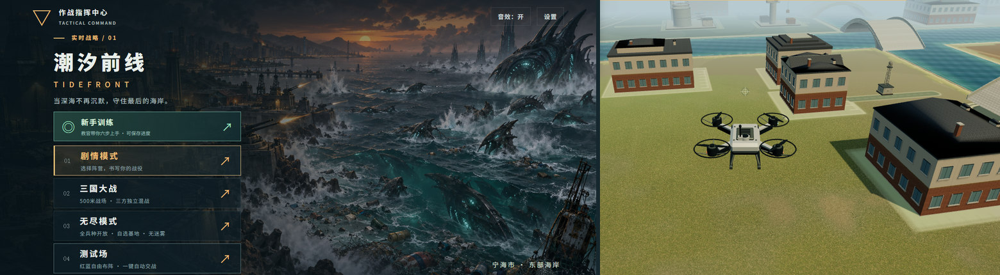
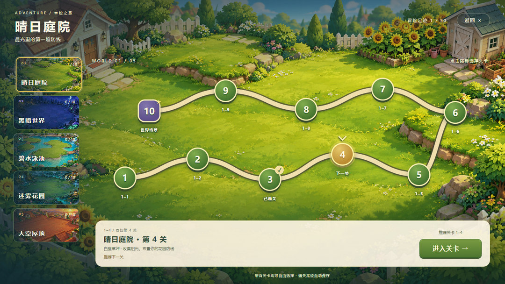
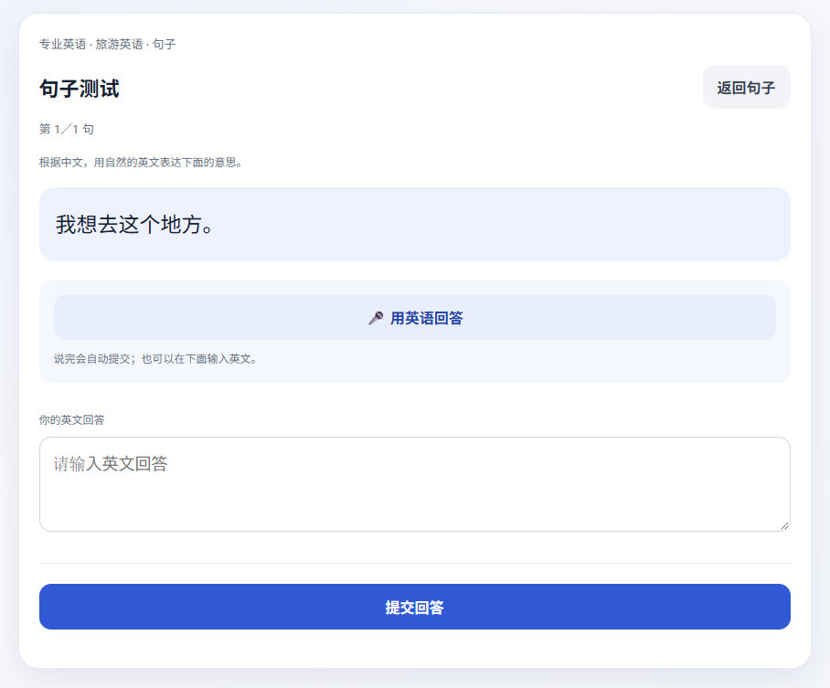
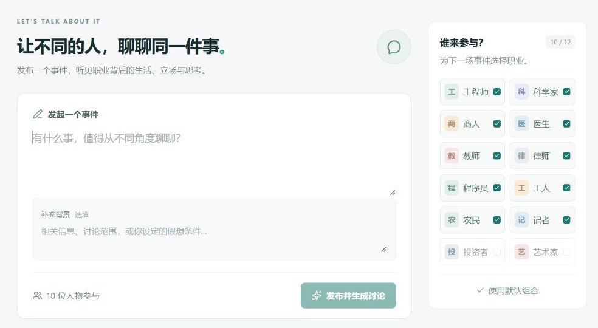

# 我是 hehaoyu131-lab，这是我的 AI 作品集

我用 AI 做游戏，也做自己想用的软件。在《潮汐前线》里，我想让玩家既能俯视整片战场，也能飞到桥边看一次交锋。在《学习空间》里，我给做了一半的试卷留了个位置，明天打开还能接着答。

## 潮汐前线 · 即时战略游戏

地表、海底和外星三个阵营在同一张地图交锋。玩家可以框选部队、编队下令，切进第一人称，或者把三方交给 AI，自己驾驶观战无人机沿河查看战况。我把剧情战役、无尽防守和房间码联机都做进了这个项目，也打包了 Windows 和 Android 版。

[查看三方 AI 对战的完整游戏画面](portfolio/tidefront-field.jpg)

## 游戏与桌面角色

| **《植物大战僵尸》同人改版** | **桌边小伙伴 · DesktopBuddy** |
| --- | --- |
|  |  |
| 我给塔防关卡加上了分支进化和角色剧情。沿着「晴日庭院」选关，战前搭配植物，战后回家园和伙伴互动。27 页植物图鉴把能力说明和角色小故事放在一起。 | 我做了一个待在 Windows 桌边的透明小伙伴。敲键时它跟着敲，挪动鼠标时视线也会跟过来。打开麦克风，它会随音量张嘴。C# 桌面版内置 15 位角色，图里是其中的两位。 |

## 学习与 AI 工具

| **学习空间** | **众声 · AI 讨论工作台** |
| --- | --- |
| 日语、英语、数学、地理和历史可以在同一个应用里切换。日语 JLPT 和英语英检模拟卷每套 30 题，中途退出可以续答。练旅游英语时，看到「我想去这个地方」，可以直接开口作答。项目有 Windows 和 Android 版。 | 输入一个事件，挑选参与讨论的职业。教师、工程师、记者等 AI 角色各自发言，你可以追问其中一位，也可以让两位角色直接回应彼此。我用 Ollama 在本机跑通了 Qwen3 4B 的讨论流程。 |
|  |  |

## 两个浏览器实验

**对数实验室 · LOG vs ∞**　我把「取一次对数，数字能缩小多少」做成了一个 50 秒的小游戏。操控绿色小球撞向目标，每撞一次，目标就缩小一层。挑战是把它压到 1。单个 HTML 文件可以离线运行，也可以切换成自动演示。[查看游戏画面](portfolio/log-lab.jpg)

**绘境 · AI 绘画工作室**　一个从文字描述走到图片再创作的工作台原型。可以选画风和比例、上传已有图片、调节改画幅度，再把结果带回画布继续修改。已完成界面交互和模拟接口验证，真实绘图服务待联调。
